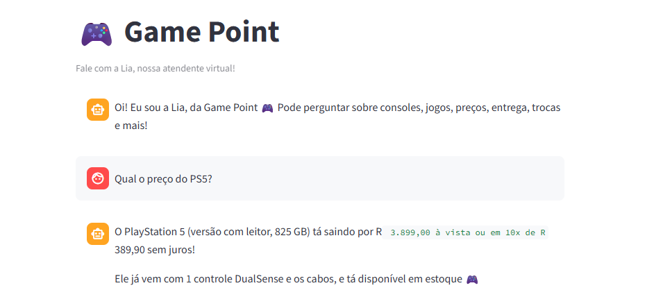

# Lia — Chatbot da Game Point

Chatbot de atendimento de uma loja fictícia de jogos e videogames, feito com **LLM (Gemini) + base de conhecimento em JSON + interface gráfica (Streamlit)**.

## Como funciona

1. O usuário digita uma pergunta na interface (Streamlit).
2. O programa **busca no `base_conhecimento.json`** os itens mais relevantes (palavras-chave + pontuação).
3. Esses trechos, a pergunta e o histórico recente são enviados ao **LLM (Gemini)**, com instruções para responder apenas com base nas informações fornecidas.
4. O LLM interpreta a pergunta e gera a resposta no tom da Lia (simpática e informal).
5. A resposta aparece no chat.

Se a pergunta não estiver coberta pela base, a Lia avisa que não tem a informação em vez de inventar.

## Arquivos

| Arquivo | Função |
|---|---|
| `app.py` | Interface, busca no JSON, montagem do prompt e chamada ao LLM |
| `base_conhecimento.json` | Base de conhecimento da loja (28 itens) |
| `requirements.txt` | Dependências |

## Como executar

```bash
pip install -r requirements.txt
```

Gere uma chave gratuita no [Google AI Studio](https://aistudio.google.com/apikey) e defina:

```bash
# Linux / macOS
export GEMINI_API_KEY="sua_chave"

# Windows (PowerShell)
$env:GEMINI_API_KEY="sua_chave"
```

Depois rode:

```bash
streamlit run app.py
```

Se preferir não usar variável de ambiente, cole a chave no campo da barra lateral do app.

## Exemplos de perguntas

- Qual o preço do PS5?
- Vocês aceitam Pix? Tem desconto?
- Quanto tempo demora a entrega?
- Posso devolver um jogo que comprei online?
- Vocês compram videogame usado?
- Que horas a loja abre no domingo?
- Qual a melhor pizza da cidade? (pergunta fora do tema: a Lia deve recusar com simpatia)

## Personalizar

- **Outro tema:** troque o conteúdo do JSON e os dados de `empresa`.
- **Outro LLM:** só a função `perguntar_llm` em `app.py` precisa mudar.
- **Ver a busca funcionando:** marque "Mostrar trechos consultados no JSON" na barra lateral.

## Exemplo 


